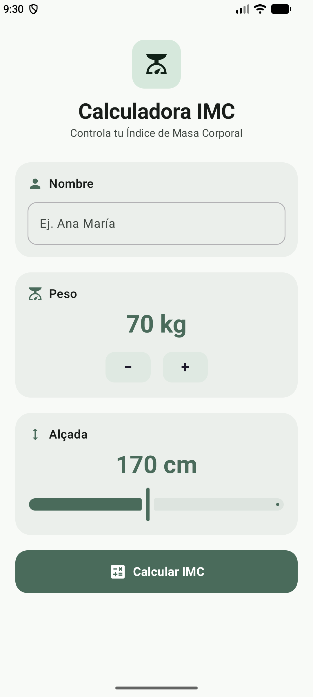

# 🧮 Calculadora IMC

Aplicación Android desarrollada con **Kotlin y XML** para calcular el Índice de Masa Corporal (IMC) mediante una interfaz sencilla y moderna.

## ✨ Funcionalidades

- Introducir el nombre del usuario.
- Ajustar la altura mediante una barra deslizante.
- Aumentar o disminuir el peso con los botones `+` y `−`.
- Calcular el IMC automáticamente.
- Mostrar el resultado y su categoría orientativa.

## 🎨 Interfaz de usuario

Comparación entre el diseño inicial y el diseño mejorado.

<table>
  <tr>
    <th align="center">Antes</th>
    <th align="center">Ahora</th>
  </tr>
  <tr>
    <td align="center" width="50%">
      
    </td>
    <td align="center" width="50%">
      
    </td>
  </tr>
</table>

## 🛠️ Tecnologías

- Kotlin
- Android Studio
- XML
- Android SDK
- Git y GitHub

## 🧮 Fórmula

**IMC = peso (kg) / altura² (m)**

## 🌿 Ramas del proyecto

- **`master`**: versión básica y funcional de la calculadora.
- **`edit_style`**: versión con el diseño visual mejorado.

